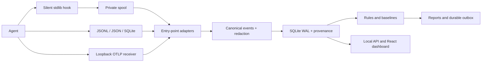

# Architecture

The package has no vendor SDK dependencies. Adapter instances declare capabilities
and provide source discovery, parser/hook/OTel mapping and optional installer/setup
methods. Entry points use `tracebook.adapters`; built-ins use that same mechanism.
Analysis, pricing, reports and the dashboard consume only canonical fields. Adding
an adapter requires its package, entry point, documented schema and fixtures.

Canonical schema version 1 has sessions, turns, model calls, tool calls and findings,
with immutable redacted raw payloads stored separately. Stable BLAKE2 IDs and source
aliases deduplicate retries/replays. Tool results link to the same native tool ID;
an out-of-order result creates a placeholder later enriched by the call. Raw data
and checkpoint writes commit together. Partial JSONL lines stay pending; file
identity/offset/tail fingerprints handle moves, rotation, truncation and rewrites.
JSON snapshots are read only when stable; concatenated telemetry objects are decoded
incrementally. Size limits are 8 MiB per JSONL record and 64 MiB per JSON snapshot.
Oversized JSONL records produce warnings; oversized snapshots surface a health error.

The daemon owns database mutations on its event loop and yields between capture
batches/files. WAL readers use separate read-only connections. An OS-backed lock
prevents duplicate daemons per state directory; SQLite serializes explicit CLI
maintenance transactions. Transport I/O runs off-thread, with outbox updates on
the writer. Source failures are isolated. The durable scheduler catches up after
sleep/restart. SIGINT/SIGTERM stop listeners/capture and close the store.

Reconciliation prefers non-null OTLP fields, then transcripts, hooks and fallback
capture. Newer revisions of equal rank win; unknown status cannot erase a known
terminal status. Native request/message/turn aliases are preferred. A unique model
call within two seconds may join uncorrelated telemetry; matching prompts within
five seconds can join hook/transcript turns. These are explicitly labeled
heuristics, not guaranteed identity. Ambiguous telemetry stays separate and is
excluded from usage totals. Without shared IDs some cross-source joins remain
unresolved. Metrics remain separate to avoid adding cumulative samples to calls.

Codex per-response usage suppresses legacy cumulative deltas for the same turn.
Claude split usage updates replace previous values. All canonical token buckets
are disjoint; `output` excludes reasoning. Unknown fields/costs remain null.
Wall timestamps normalize to UTC milliseconds; missing clocks use an explicit
unknown clock source, not invented event times. Hook envelopes also retain receive
wall/monotonic clocks. Project identity uses git root plus a hash of the remote URL,
falling back to cwd. Native tools retain names alongside the canonical vocabulary.

Main prompt counts exclude built-in commands, compaction records and explicitly
identified sidechain instructions. Session boundaries are adapter-defined; missing
end events stay unknown. Findings include concrete event/call IDs, observed values,
thresholds and recommendations. Baselines use prior observations, not agent names.
The analysis pass streams evidence and bounds retained samples; no LLM is involved.

Browser views cover overview, sessions, turn details, tool IO, field provenance,
findings, reports and capability coverage. Large lists are paginated/capped. The
session drawer currently caps turns/tools at 1,000; use the database or paginated
event API for larger sessions. This limit does not truncate stored capture data.
